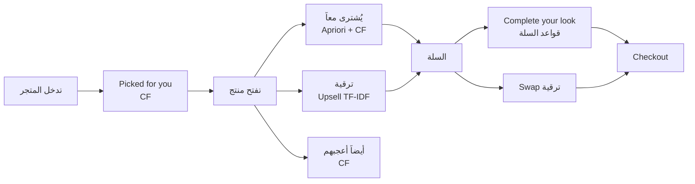
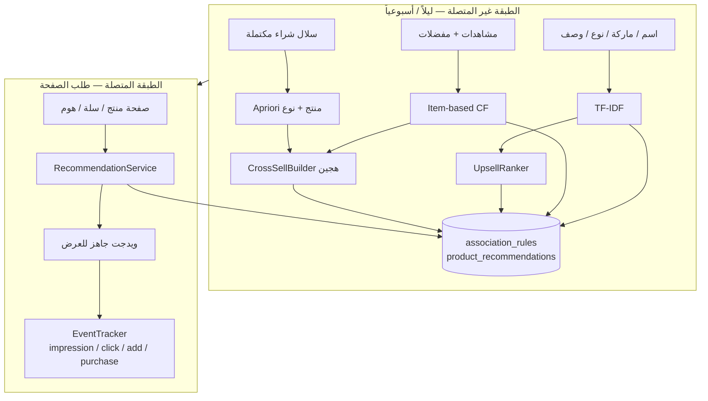
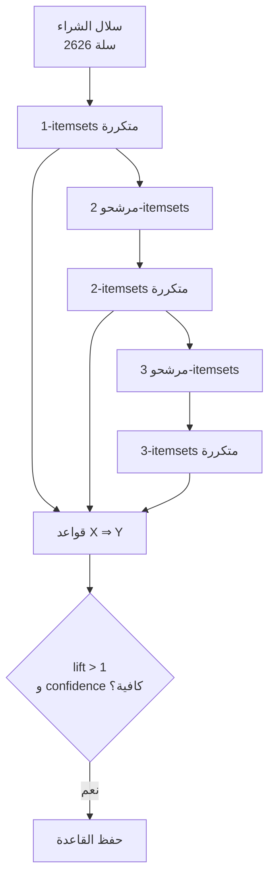
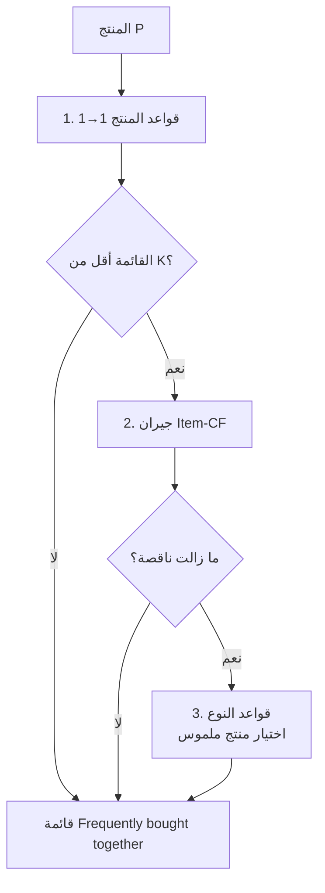
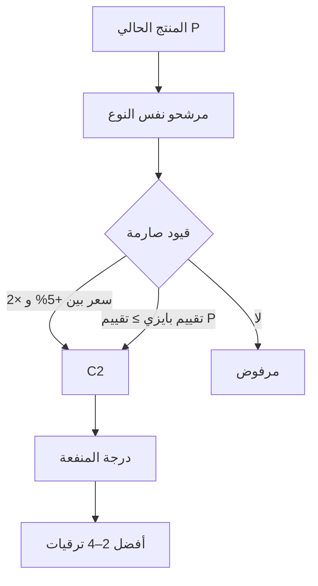
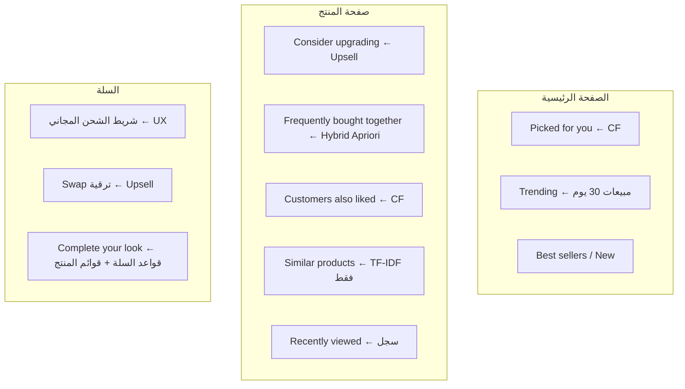

# شرح الخوارزميات لتحسين تجربة المستخدم — Noor-Store

ملف للعرض أمام الدكتور: **ماذا فعلنا، كيف تعمل الآلية، ولماذا هذا يحسّن الـ UX**.

الجملة المركزية للمشروع:

> التوصية ليست قائمة منتجات عشوائية. كل ويدجت في الواجهة يجيب على سؤال مختلف في رحلة التسوق، وخوارزمية مختلفة مسؤولة عنه.

| سؤال المستخدم | الخوارزمية | مكانها في الواجهة |
|---|---|---|
| «شو ب complementary معي؟» | **Apriori هجين مع CF** — Cross-selling | Frequently bought together + Complete your look |
| «في نسخة أفضل من اللي عم شوفه؟» | **TF-IDF + Utility** — Upselling | كرت الترقية + Swap في السلة |
| «شو يناسبني أنا؟» | **Item-based CF** — Personalisation | Picked for you + Customers also liked |

---

## 1) قصة المستخدم (UX story)

**سارة** تدخل Noor-Store تبحث عن محدد شفاه.

1. **الصفحة الرئيسية** تعرض لها «Picked for you» — منتجات قريبة من سلوك زبائن يشبهونها (CF).
2. تفتح **Lippie Pencil بـ 3.65$**. النظام يقترح:
   - **ترقية** (Upsell): NYX Slim Lip Pencil أغلى شوي وأعلى تقييماً — نفس النوع، مو منتج ثاني.
   - **يُشترى معاً** (Cross-sell): أحمر شفاه + محدد إضافي — مكملات الروتين، مو بدائل.
   - **Customers also liked** (CF): زبائن اشتروا هذا المحدد أعجبهم أيضاً هذه المنتجات.
3. تضيف المحدد للسلة. صفحة السلة تقول:
   - كم بقي لشحن مجاني (شريط تقدّم — UX مباشر).
   - **Complete your look**: قواعد Apriori على السلة كاملة (`antecedent ⊆ cart`).
   - **Upgrade / Swap**: استبدال السطر بمنتج أفضل بدون الرجوع لصفحة المنتج.
4. عند الشراء، النظام يسجّل من أي ويدجت جاء المنتج (`rec_source`) حتى نقيس CTR لاحقاً.

هذه القصة هي حجة الـ UX: **كل خوارزمية تقلّل جهداً ذهنياً في لحظة مختلفة**.



---

## 2) المعمارية: طبقتان حتى يبقى الموقع سريعاً

التدريب ثقيل. العرض لازم يكون لحظي. لذلك فصلنا العمل:



**لماذا هذا يحسّن UX السرعة؟** صفحة المنتج لا تشغّل Apriori. تقرأ صفوفاً مفهرسة مسبقاً. سلة الـ cross-sell تستخدم عامل PostgreSQL `jsonb <@` على الـ GIN index.

---

## 3) الخوارزمية 1 — Cross-selling (Apriori متعدد المستويات + CF)

### ماذا تفعل؟
تقترح **مكملات** للمنتج الحالي: محدد شفاه → أحمر شفاه، ظلال → آيلاينر. ليست بدائل.

### الآلية

**Apriori (Agrawal & Srikant, 1994)** يستخرج قواعد ارتباط من سلال الشراء:

```
X ⇒ Y
support    = P(X ∪ Y)          كم مرة ظهرا معاً
confidence = P(Y | X)          إذا وُجد X، ما احتمال Y؟
lift       = confidence / P(Y)  > 1 يعني ارتباط حقيقي وليس صدفة
```

درجة الترتيب المستخدمة في المشروع:

```
score = 0.6 × confidence + 0.4 × (1 − 1/lift)
```

الثقة تقول «القاعدة موثوقة»، والـ lift يقول «أقوى من العشوائية».



خاصية Apriori: إذا مجموعة غير متكررة، كل مجموعة أكبر منها غير متكررة. لذلك لا نفحص كل التوافيق.

### لماذا مستويان؟ (Han & Fu, 1995)

- **مستوى المنتج**: `{Lippie Pencil} ⇒ {Lippie Stix}` — دقيق لكن تغطيته ضعيفة (~14% من الكتالوج بقواعد المنتج وحدها).
- **مستوى النوع**: `{lipstick} ⇒ {lip_liner}` — يحل الـ cold-start للمنتجات الجديدة/النادرة، ثم نختار منتجاً ملموساً حسب تشابه CF + نفس الماركة + الشعبية.

### الهجين الإنتاجي

التقييم أثبت أن CF وحده أقوى من Apriori وحده في إكمال السلة. لذلك الإنتاج يملأ القائمة بهذا الترتيب:



**نتيجة التقييم (K=5، تقسيم زمني):**

| الطريقة | HitRate@5 | المعنى للدكتور |
|---|---|---|
| Hybrid Apriori+CF | **0.59** | الأفضل للـ cross-sell |
| Item-CF وحده | 0.59 | قوي لكن أقل تفسيراً |
| Apriori متعدد المستويات | 0.55 | قابل للشرح بقواعد |
| Apriori منتج فقط | 0.40 | تغطية ضعيفة |
| Popularity | 0.15 | خط أساس |
| Random | 0.01 | خط أساس |

HitRate@5 = في 59% من الحالات، أحد مكملات السلة الحقيقية ظهر ضمن أول 5 توصيات.

### مثال قصة للشرح الشفهي

زبون اشترى **ظلال عيون**. القاعدة الأقوى في البيانات: عيون + محدد عيون يظهران معاً مئات المرات. الواجهة لا تقول «منتجات مشابهة»؛ تقول **Frequently bought together** وتسمح بـ **Add all**. هذا يقلّل خطوات إكمال الروتين من بحث متعدد إلى نقرة واحدة.

على السلة: إذا السلة تحتوي [محدد، أحمر شفاه]، نبحث قواعد `antecedent ⊆ السلة` — قاعدة من عنصرين أدق من قاعدة من عنصر واحد.

---

## 4) الخوارزمية 2 — Upselling (TF-IDF + Utility)

### ماذا تفعل؟
تقترح **بديلاً أفضل وأغلى قليلاً من نفس النوع**. محدد رخيص → محدد أعلى تقييماً بنسبة سعر منطقية.

### لماذا ليست Apriori؟
الزبون نادراً ما يشتري المنتج وترقيته معاً. سجلات الشراء لا تحتوي «الحقيقة» للـ upsell. لذلك نستخدم محتوى المنتج + قيود جودة/سعر.



### درجة المنفعة

```
score = 0.40·similarity + 0.25·qualityGain + 0.20·priceFit + 0.15·popularity
```

| المعيار | المعنى UX |
|---|---|
| تشابه TF-IDF (40%) | الترقية تبقى ضمن نية البحث (ماركة، نوع، وصف) |
| مكسب الجودة (25%) | تقييم بايزي أعلى — مو منتج بـ 5 نجوم من مراجعة واحدة |
| ملاءمة السعر (20%) | منحنى غاوسي حول **+35%** — قفزة السعر الكبيرة تُرفض نفسياً |
| الشعبية (15%) | إثبات اجتماعي |

**متوسط بايزي (صيغة IMDb):**

```
bayes = (v·R + m·C) / (v + m)
```

`v` عدد المراجعات، `R` المتوسط، `C` متوسط الكتالوج، `m = 5`. يمنع منتجاً بنجمة واحدة من التفوّق على منتج بـ 80 مراجعة و 4.6.

**TF-IDF:** كل منتج وثيقة من الاسم + الماركة + النوع + الشكل + الوسوم + الوصف. التشابه = جيب تمام المتجهات. هذا يضمن أن الترقية «نفس الفكرة» وليس أي أحمر شفاه أغلى.

### مثال قصة

سارة تشوف Lippie Pencil بـ 3.65$. النظام يعرض NYX Slim Lip Pencil أغلى بنسبة معقولة وأعلى تقييماً، مع جملة **Consider upgrading / Swap**. ما في بحث، ما في مقارنة يدوية. هذا هو تحسين UX للـ upsell: قرار أوضح بخطوة أقل.

---

## 5) الخوارزمية 3 — Item-based Collaborative Filtering

### ماذا تفعل؟
تجيب: **زبائن سلوكهم قريب منك أعجبهم أيضاً…**

مراجع: Sarwar et al. 2001، Deshpande & Karypis 2004.

### لماذا item-based وليس user-based؟
تشابه المنتجات مستقر ويُحسب Offline. تشابه المستخدمين يتغيّر مع كل جلسة. مناسب للكتالوج (~900 منتج) ولزائر ضيف له مشاهدات فقط.

```mermaid
flowchart LR
    subgraph Signals["إشارات ضمنية"]
        PUR[شراء = 3]
        WISH[مفضلة = 2]
        VIEW[مشاهدة = 1]
    end
    Signals --> M[مصفوفة مستخدم × منتج]
    M --> SIM[cosine + shrinkage λ=5]
    SIM --> N[لكل منتج: 30 جاراً]
    N --> SC[score j = Σ w(u,i)·sim(i,j)]
    SC --> TOP[Top-N للشخص]
```

**وزن الأهمية (Koren 2008):**

```
sim(i,j) = cos(i,j) × n_ij / (n_ij + λ)
```

زوج ظهر مع مستخدمين قليلين لا يسيطر على الترتيب.

**أونلاين:** تاريخ المستخدم يتلاشى بعمر 30 يوماً (نصف عمر)، والمشتريات تُستبعد حتى لا نعيد نفس المنتج.

### مثال قصة

سارة شاهدت محددات وما اشترت بعد. الصفحة الرئيسية تملأ **Picked for you** من جيران هذه المحددات. بعد أول طلب، التوصية تصبح أقوى لأن وزن الشراء = 3. للزائر الجديد بدون تاريخ: نسقط إلى **Trending** (30 يوماً) — ما في صفحة فارغة.

---

## 6) خريطة الواجهة ← الخوارزمية (للدكتور)



**Similar ≠ Also liked:** Similar محتوى (شكل المنتج). Also liked سلوك زبائن. عرض الاثنين يوضح للدكتور أن الخوارزميات ليست مكررة.

---

## 7) حل مشاكل UX كلاسيكية في التوصية

| مشكلة | الحل في المشروع |
|---|---|
| Cold-start لمنتج جديد | قواعد النوع + محتوى TF-IDF + Trending |
| توصية غير مفسَّرة | Apriori يعطي confidence/lift تُعرض منطقياً «يُشترى معاً» |
| بطء الصفحة | تدريب Offline + كاش بإصدار النموذج |
| تكرار نفس المنتج | استبعاد السلة والمشتريات |
| ترقية سيئة (أغلى بكثير / أسوأ تقييماً) | قيود السعر والتقييم البايزي |
| قياس هل الواجهة تفيد؟ | `recommendation_events` + `rec_source` على بنود الطلب |

---

## 8) كيف نُقيّم علمياً (ليس إحساس)؟

تقسيم **زمني**: آخر طلب لكل زبون = اختبار، ما قبله = تدريب. لا تسرّب من المستقبل.

- **مهمة أ — إكمال السلة (cross-sell):** أخفِ عنصراً من السلة، هل نعيده ضمن Top-5؟
- **مهمة ب — السلة التالية (CF):** من التاريخ، هل نخمّن مشتريات الطلب التالي؟
- **Upsell:** لا حقيقة في السجلات → نقاس جودة وصفية: مكسب التقييم، نسبة الرفع السعرية، التشابه.

هذا يربط تحسين UX بدليل: التوصية تصل للمنتج الذي اشتراه الزبون فعلاً أكثر من الشعبية والعشوائية.

---

## 9) نص شرح شفهي (~3 دقائق)

1. **المشكلة UX:** كتالوج 900+ منتج. الزبون يضيع بين البحث والمقارنة وإكمال الروتين.
2. **الفكرة:** ثلاث لحظات قرار → ثلاث خوارزميات، مو خوارزمية واحدة لكل شيء.
3. **Cross-sell:** «ماذا يُشترى معاً؟» من سلال حقيقية (Apriori)، ونكمل التغطية بـ CF لأن التقييم أثبت أن الهجين أعلى HitRate.
4. **Upsell:** «نسخة أفضل؟» من المحتوى والسعر والتقييم، لأن السلال لا تعلّم البدائل.
5. **CF:** «ماذا يناسبني؟» من الشراء/المشاهدة مع تلاشي زمني.
6. **التنفيذ:** Offline نحسب، Online نعرض بسرعة، ونسجّل النقرات حتى نغلق حلقة القياس.
7. **النتيجة:** HitRate@5 ≈ 0.59 مقابل 0.15 للشعبية — التوصية أوضح وأقصر في الواجهة.

---

## 10) مراجع مختصرة تُذكر أمام اللجنة

- Agrawal & Srikant (1994) — Apriori
- Han & Fu (1995) — multi-level association rules
- Salton & Buckley — TF-IDF
- Sarwar et al. (2001) / Deshpande & Karypis (2004) — item-based CF
- Koren (2008) — significance weighting / shrinkage
